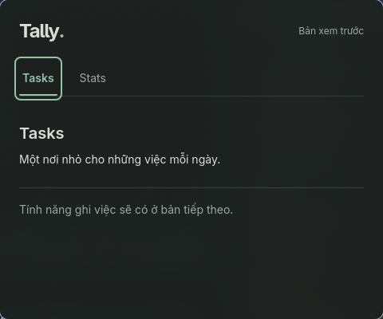
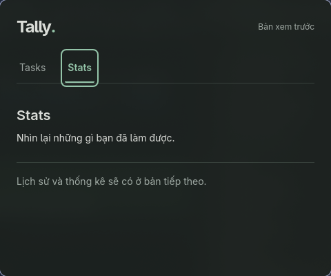
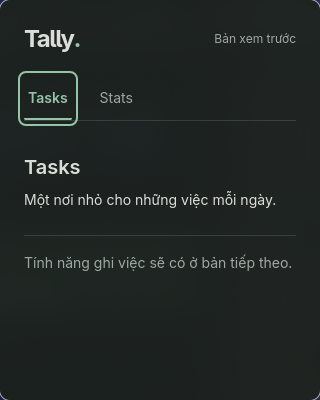

# TAL-1: Bằng chứng và handoff

- Ngày: 2026-10-18, timezone `Asia/Ho_Chi_Minh`.
- Nhánh: `feature/tal-1-scaffold`; base `516fb3f`. Evidence local được ghi trước
  commit bàn giao; không phải artifact phát hành.
- Phạm vi: [spec đã duyệt](tal-1-scaffold-ci.md), [plan](tal-1-plan.md),
  [checklist](tal-1-todo.md).
- Maintainer đã review và cho phép commit/push/mở PR TAL-1. Không merge/publish,
  sửa branch rules hay worktree khác; Kaneo giữ In Review đến khi PR thực sự merge.

## Môi trường

CachyOS x86_64, Linux 7.2.8-1-cachyos, Hyprland 0.56.2/Wayland;
WebKitGTK 4.1 package 2.52.6, GTK 3.24.52. Node 24.20.0, pnpm 10.34.7;
Rust/Cargo 1.98.1 từ distro, rustfmt 1.9.0, clippy 0.1.98.
Cargo jobs giới hạn 4 khi build/check/test, không dùng số liệu build làm benchmark.
CI cấu hình official Rust 1.98.0 trên Ubuntu 24.04. Tại thời điểm ghi evidence
local chưa chạy remote; trạng thái chạy thực tế được báo trong PR bàn giao.

## Commands và kết quả local

| Command | Kết quả |
| --- | --- |
| `pnpm install --frozen-lockfile` | Pass; lockfile khớp manifest |
| `pnpm check` | Pass; svelte-check 0 errors/0 warnings và TypeScript strict |
| `pnpm lint` | Pass; ESLint và Prettier check source/config |
| `pnpm test --run` | Pass; 3 test navigation và 4 test CLI/profile boundary |
| `pnpm build` | Pass; frontend production |
| `cargo fmt --manifest-path src-tauri/Cargo.toml --all -- --check` | Pass |
| `cargo clippy --manifest-path src-tauri/Cargo.toml --locked --all-targets -- -D warnings` | Pass |
| `cargo test --manifest-path src-tauri/Cargo.toml --locked` | Pass; 5 test profile/root isolation |
| `pnpm audit --audit-level high` | Pass; no known vulnerabilities |
| `cargo audit --file src-tauri/Cargo.lock` | Exit 0; 412 dependencies, 2 informational warnings bên dưới |
| `pnpm tauri build --no-bundle -- --locked` | Pass; native release build, lần build đầu 1m42s |
| `actionlint .github/workflows/ci.yml` | Pass, actionlint 1.7.7 |
| `python3 scripts/check_repository.py` | Pass, kiểm tra file/link/metadata |
| `git diff --check` | Pass |

Audit tool 0.22.2 được cài isolated bằng
`cargo install cargo-audit --version 0.22.2 --locked --root /tmp/tally-tools --target-dir /tmp/tally-audit-target --jobs 3`;
command thực thi local là `/tmp/tally-tools/bin/cargo-audit audit --file src-tauri/Cargo.lock`.
Actionlint cũng cài trong `/tmp/tally-tools/bin`; không thêm binary vào repo hoặc
đổi Rust hệ thống. Không coi tools trong `/tmp` là prerequisite bền vững.

### Test có bắt được lỗi

- UI RED: trước khi có navigation, cả 3 test fail vì không tìm thấy button
  Tasks/Stats. GREEN: shell có control và content switching, cả 3 pass.
- Rust RED: resolver chưa tách namespace, 4/5 test fail (root lỗi đã được propagate).
  GREEN: namespace được validate và ghép đúng, cả 5 pass.
- Mutation review: đảo `!root.is_absolute()` thành `root.is_absolute()` khiến
  `relative_root_is_rejected` fail. Đã khôi phục source trước các check cuối.
- Rust CI không cài frontend: kiểm tra lại Cargo test khi không có `dist`, để
  tránh phụ thuộc output build có sẵn trên máy local.
- Bản sao source sạch, không có `node_modules`/`dist` cũ: frozen install,
  check/lint/test/build và repository check đều chạy thành công.
- CLI regression RED/GREEN: config dev ban đầu lọt vào runner arguments sau `--`;
  test tái hiện rồi sửa bằng cách chèn config trước separator. Test thêm giữ
  identity dev khi `--release`, build args và exit code thất bại của command con.
  Smoke lại `pnpm tauri dev -- --locked` khởi động thành công: đây là tham số
  cho Cargo runner, không phải tham số app. Exit code command sai cũng được
  giữ nguyên, không đổi thành thành công.

## Smoke desktop thật

Dev chạy bằng `pnpm tauri dev` trong namespace XDG tạm
`/tmp/tally-smoke-dev.mfKjor`; WebView ghi dưới
`data/io.github.namdang-fdp.tally.dev`, không có DB nghiệp vụ.

Đã quan sát trong cửa sổ Tauri/WebKitGTK:

1. Khởi động vào Tasks, hai button có tên accessible; landmark/heading đúng.
2. Click Stats đổi heading và nội dung giữ chỗ; không tạo cửa sổ mới.
3. Tab/Enter và Shift+Tab/Space đổi view; accessibility tree xác nhận nội dung
   và focus, ảnh cho thấy focus ring thật.
4. Gửi close request qua compositor: app thoát 0. Chạy lại dev vào Tasks;
   lần chạy lại không có output lỗi trước khi đóng.



Release executable: `src-tauri/target/release/tally`, không phải package cài đặt.
Vite đã dừng (`127.0.0.1:1420` trả connection refused). Chạy bằng:

```sh
XDG_DATA_HOME=/tmp/tally-smoke-release.vGhW0Z/data \
XDG_CACHE_HOME=/tmp/tally-smoke-release.vGhW0Z/cache \
XDG_CONFIG_HOME=/tmp/tally-smoke-release.vGhW0Z/config \
unshare --user --map-current-user --net ./src-tauri/target/release/tally
```

Các thư mục `/tmp` là fixture của lần đo, cần tạo thư mục tạm mới khi tái kiểm tra.
`unshare` chỉ áp dụng cho process smoke; không đổi network hoặc cấu hình OS của user.
Process có net namespace khác host; `/proc/<pid>/net/dev` chỉ có loopback, không
có interface ra ngoài. Không tắt WebKit sandbox hoặc nới capabilities để chạy.

- Release mở đúng Tasks khi không có Vite/mạng, chuyển Stats bằng click/Enter,
  quay Tasks bằng Shift+Tab/Space; focus ring nhìn thấy.
- WebView ghi vào `data/io.github.namdang-fdp.tally`, tách identifier dev.
- Đã xem shell ở 480×400 và 320×400; text không tràn ngang, control vẫn truy cập được.
- Đóng release thoát 0; process Rust và hai process WebKit của lần chạy đều biến
  mất. Mở lại release trong cùng fixture vào Tasks, đóng lại thoát 0, không output lỗi.
- Hyprland mặc định tile cửa sổ; chỉ float/resize cửa sổ Tally để kiểm tra kích
  thước, không thêm window rule hoặc đổi keybind của user.




Orca accessibility action không tự chứng minh kết quả; đã đọc lại tree và chụp
cửa sổ bằng `grim`. Synthetic key của Orca không chứng minh được input Wayland;
smoke bàn phím dùng `hl.dsp.send_shortcut` của compositor và quan sát lại app.
Một số lần quét accessibility phát ra GTK/ATK `impl_get_NActions: ATK_IS_ACTION`
critical warnings. Lần mở/đóng không quét không có output này; chưa kết luận
nguyên nhân upstream/tool đã được sửa, không tuyên bố mọi runtime log sạch.

## Dependency audit và review

`cargo-audit` không báo vulnerability làm exit khác 0, nhưng giữ nguyên hai
warning mặc định, không có ignore list:

| Advisory | Nguồn | Đánh giá trong scope |
| --- | --- | --- |
| [RUSTSEC-2024-0370](https://rustsec.org/advisories/RUSTSEC-2024-0370) | proc-macro-error 1.0.4 qua gtk3-macros/glib-macros | Unmaintained; build dependency upstream, không có bản vá trong dòng này |
| [RUSTSEC-2024-0429](https://rustsec.org/advisories/RUSTSEC-2024-0429) | glib 0.18.5 qua GTK/WebKit/Tauri | Unsound `VariantStrIter`, upstream fix ở glib ≥0.20; không thể bump riêng major của binding GTK3 chỉ bằng lockfile |

Đã đọc advisory và `cargo tree --invert`. Source scan app cùng Tauri/runtime,
tao, wry, gtk, gio, gdk, muda đang chọn không tìm thấy `VariantStrIter`/`str_iter()`.
Đây là bằng chứng giới hạn của shell hiện tại, không phải chứng minh reachability
toàn bộ hệ thống hoặc miễn review trước release. Maintainer cần review lại nếu
thêm dùng GVariant hoặc đổi dependency; chưa publish nên chưa tạo ngoại lệ release.

Review source/config: capabilities rỗng cho frontend IPC; không shell/filesystem/
HTTP plugin. Release CSP không cho remote asset, inline script hoặc inline style;
dev chỉ thêm loopback Vite/HMR và inline style phục vụ HMR. UI render text thường,
không DB/localStorage task, no cloud/account/telemetry. Dependency trực tiếp pin
exact, metadata license MIT/Apache-2.0; lockfiles không có git dependency tùy ý.

## Giới hạn và handoff

Các nhóm file thay đổi:

| Nhóm | File |
| --- | --- |
| Tooling frontend | `package.json`, `pnpm-lock.yaml`, `tsconfig.json`, `vite.config.ts`, `svelte.config.js`, `eslint.config.js`, `.prettierrc.json`, `.prettierignore`, `index.html` |
| Shell và tests | `src/main.ts`, `src/App.svelte`, `src/app.css`, `src/App.test.ts`, `src/test-setup.ts`, `scripts/tauri.mjs`, `scripts/tauri.test.ts` |
| Native | `src-tauri/Cargo.toml`, `src-tauri/Cargo.lock`, `src-tauri/build.rs`, `src-tauri/src/{main,lib,profiles}.rs`, `src-tauri/tauri*.conf.json`, `src-tauri/capabilities/main.json`, `src-tauri/icons/icon.png` |
| CI | `.github/workflows/ci.yml`, `.github/dependabot.yml`, `.gitignore` |
| Tài liệu | `README.md`, `AGENTS.md`, `CONTRIBUTING.md`, `CHANGELOG.md`, `docs/{architecture,development,maintaining}.md`, spec/plan/todo/evidence/ảnh TAL-1 trong `docs/specs/` |

- Actionlint và command local không chứng minh runner Ubuntu/Rust 1.98.0 đã đạt.
  Theo dõi kết quả GitHub Actions trong PR trước khi maintainer cập nhật required
  checks. Không đánh dấu TAL-1 Done trước review/tích hợp.
- Chưa đóng gói/chạy AppImage/deb/rpm, chưa kiểm chứng Windows/macOS; không có số
  liệu hiệu năng/RAM/CPU. Ảnh chỉ phản ánh system dark trong lần chạy này.
- Không nghiệm thu shortcut, toggle, single-instance, input IME, task CRUD,
  SQLite/history/Stats nghiệp vụ. Các mục đó nằm ngoài TAL-1.
- TAL-1 cung cấp nền cho TAL-3; UI đầy đủ và mặc định MVP còn mở vẫn cần checkpoint
  tương ứng. File ownership giữ ở root configs, shell frontend/Rust, CI và docs.
